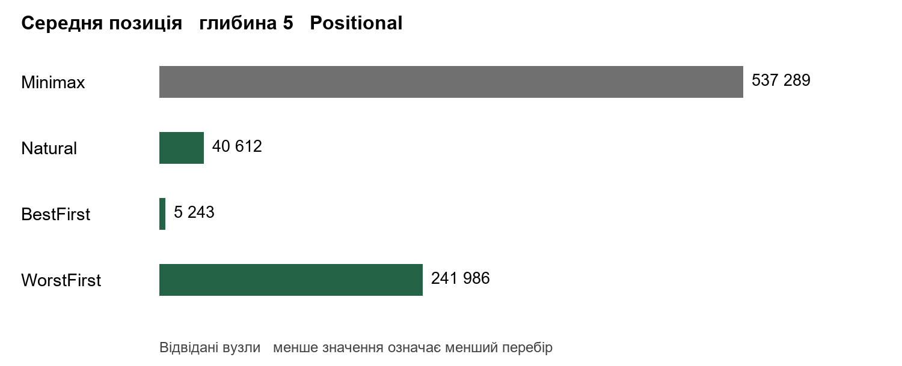

# Reversi AI Lab — Черниченко Надія, ТТП-42

Навчальний проєкт з теми «Абстрактні стратегічні ігри». C# / .NET 10. Гра 8×8 із законними ходами, перевертанням фішок, обов'язковими пропусками та закінченням партії. Реалізовано **minimax** і **alpha-beta** з однаковою глибиною, дві оцінки, три порядки ходів, трасу дерева, графічний застосунок та автоматичні експерименти.

## Перевірені результати

13 листопада 2026 року виконано **200 перевірок** і **432 експериментальні вимірювання** у Release на .NET 10. У всіх парних запусках оцінки minimax та alpha-beta збіглися. Для середньої позиції, глибини 5, Positional і BestFirst кількість вузлів скоротилася з **537 289 до 5 243** — на **99,02%**. Це результат конкретної позиції; BestFirst не гарантує найменшого дерева в кожному випадку.



Звіт: [Word українською](docs/Reversi_Звіт_Черниченко.docx). [Матеріали захисту](docs/Захист.md). Дані: [CSV](results/experiments.csv), [зведення](results/summary.json), [середовище](results/environment.json), [протокол перевірок](results/tests.txt).

## Запуск у Visual Studio 2026 (Windows)
1. Встановити навантаження **.NET desktop development** і .NET 10 SDK.
2. Відкрити `Reversi.Desktop/Reversi.Desktop.csproj`, вибрати **Reversi.Desktop** як стартовий проєкт, запустити F5.
3. Натискати на зелені позначки допустимих ходів. Кнопка **Хід AI** виконує один хід пошуком; **Порівняти алгоритми** дає метрики; **Дерево та alpha/beta** показує журнал та дозволяє експортувати JSON. Обчислення виконуються у фоні, кнопка **Скасувати** перериває їх без застосування незавершеного результату.

## Команди в PowerShell з кореня репозиторію
```powershell
dotnet run --project Reversi.Tests -c Release
dotnet run --project Reversi.Experiments -c Release -- results
dotnet run --project Reversi.Desktop -c Release
```

## Відтворювані експерименти
- Початкова, середня та пізня позиції з відтворюваної партії (правило вибору індексу `(turn*7+3) % legalMoves.Count`).
- Глибини 2–5, два HEF, три порядки ходів (Natural / BestFirst / WorstFirst), обидва алгоритми, 3 повтори.
- CSV: `results/experiments.csv`; дерево: `results/tree_midgame.json`; позиції: `results/positions.txt`.
- Вимірюється час у мс, кількість відвіданих вузлів, листків та фактичних відтинань. Перед записаними повторами прогріваються обидва методи для кожної конфігурації; порядок вимірювання методів чергується. `summary.json` містить медіани трьох повторень, `environment.json` — умови запуску.
- Порівняння часу виконуйте в Release без відлагоджувача; враховуйте прогрів JIT та фонові процеси. Результати часу не гарантовано монотонні.
- При однаковій глибині й HEF score minimax та alpha-beta має збігатися. Якщо кілька ходів мають однакову оцінку, порядок може змінити обраний хід, але не оптимальне значення.

## Структура
- `Reversi.Core/Board.cs`: стан, генерація легальних ходів, перехід, пропуск, термінальність.
- `Reversi.Core/Evaluation.cs`: UF та дві HEF.
- `Reversi.Core/Search.cs`: обидва пошуки, заміри, журнал вузлів з батьківськими ID та α/β.
- `Reversi.Desktop`: інтерфейс Windows Forms.
- `Reversi.Tests`: перевірки правил і тотожності результатів алгоритмів.
- `Reversi.Experiments`: масові експерименти без інтерфейсу.
- `docs`: звіт і матеріали до захисту.

## Важливі деталі
- Чорні `B = +1`, білі `W = -1`; MAX — той, хто ходить у корені пошуку.
- Пропуск **не є ходом для вибору**, а обов'язково застосовується, якщо немає жодного легального ходу; глибина після пропуску зменшується на 1.
- HEF: для DiscDifference різниця числа фішок; Positional = позиційна таблиця + 25×мобільність + 45×кутові клітинки + 5×потенційну мобільність + змінна вага різниці фішок. Ваги є обраними евристичними припущеннями, не навченими коефіцієнтами.
- UF: виграш `100000+discDiff`, програш `-100000+discDiff`, нічия `0`.
- BestFirst і WorstFirst лише **впорядковують усі ходи**, не відкидаючи жодного: це точна, а не селективна модифікація.
- У JSON журнал збережено в порядку завершення рекурсивних викликів; `Id` та `Parent` дозволяють відтворити дерево. `Cutoff=true` означає, що умова α≥β пропустила хоча б одного наступного нащадка. Порожнє відтинання на останньому ході не рахується. У відсіченому внутрішньому вузлі Score може бути лише межею; кореневе minimax-значення залишається точним для заданої глибини.
- `traceLimit` зберігає вузли з `Id < traceLimit`, тому обмежена траса містить корінь і всіх предків кожного збереженого вузла. Після ручного ходу попередня траса очищується.
- `Board.Cells` доступний тільки для читання. `SearchEngine` підтримує `CancellationToken`; для одночасних пошуків слід створювати окремі екземпляри двигуна.

## Перевірка і відтворення звіту

Консольні перевірки охоплюють вісім напрямків захоплення, примусові пропуски, завершення з порожніми клітинками, недопустимі параметри, кількість листків початкового дерева до глибини 6, вісім повних партій, точний перебір кінцевих позицій, оптимальність повернутого ходу, трасування і скасування. CI збирає рішення й запускає цей застосунок перевірок. Команда `dotnet test` не запускає ці консольні перевірки.

Для оновлення звіту після експериментів збережіть протокол перевірок як UTF-8 у `results/tests.txt`, встановіть `python-docx` і `Pillow` та виконайте `python scripts/build_report.py`. Це відтворює DOCX і діаграму з CSV/JSON. Метадані CPU та SDK записані для опублікованого запуску; сам експериментатор автоматично зберігає ОС, архітектуру, runtime та кількість процесорів.

## Обмеження
Розмір дошки фіксовано 8×8, графічний застосунок працює на Windows. Таблиці транспозицій, ітеративне заглиблення, автоматичний ліміт часу та турнірна оцінка сили HEF не реалізовані. Ефект обрію та задані вручну ваги залишаються обмеженнями. Часові результати залежать від обладнання та навантаження.
